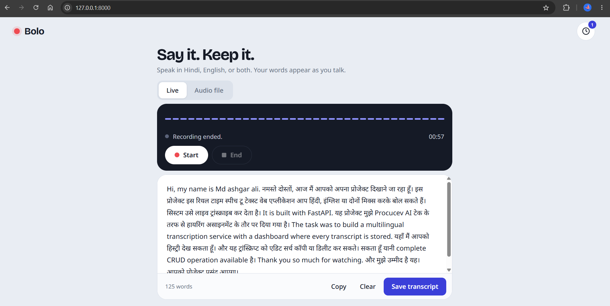
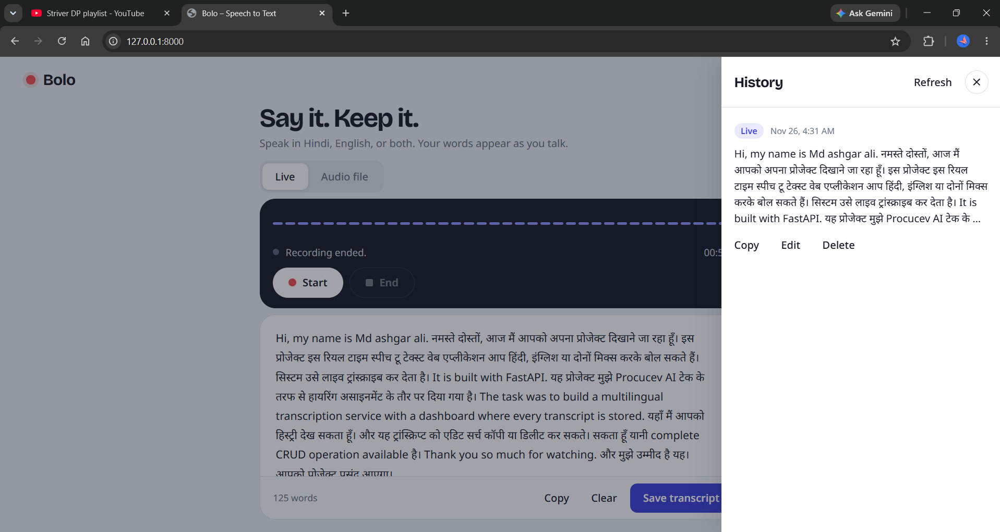
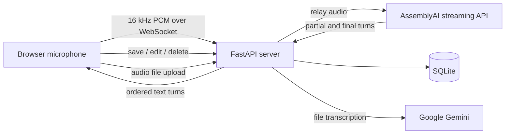

# Bolo: Real-Time Speech to Text (Hindi, English and Hinglish)

A full-stack web app that transcribes speech live as you talk, transcribes uploaded audio files, and stores a searchable history of transcripts. Built end to end by me: backend, real-time audio pipeline, database and UI.

**Live demo:** [Live link](https://realtime-speech-to-text-fyii.onrender.com)
**Source:** [repository link](https://github.com/ali3825/realtime-speech-to-text)

### Bolo screenshot

**Live Transcribe Page**

---

**History Page**

---

## Why I built it

Most speech-to-text tools handle English well but struggle with Indian-language and mixed Hindi-English speech, which is how many people actually talk. I wanted a simple tool that handles that naturally, works in the browser, and keeps a history of what you dictated.

---

## What this project demonstrates

- **Real-time systems:** streaming microphone audio over WebSockets with low latency, and relaying it between a browser and a third-party streaming API.
- **Backend engineering:** a FastAPI service with REST endpoints (full CRUD), input validation, file-upload limits, async code, and worker threads for blocking calls.
- **Working with third-party AI APIs:** AssemblyAI streaming for live speech, Google Gemini for file transcription, and handling of model names, access limits and errors.
- **Debugging and decision making:** diagnosed a failing integration from logs and API data, then changed the design rather than forcing it (see below).
- **Frontend craft without a framework:** plain HTML, CSS and JavaScript, responsive layout, accessible focus states, reduced-motion support, and a designed (not templated) interface.
- **Security basics:** API keys kept on the server, secrets in environment variables, safe DOM rendering (text is inserted with `textContent`, not raw HTML).

---

## Tech stack

**Backend:** Python, FastAPI, Uvicorn, SQLAlchemy, SQLite, aiohttp
**AI / speech:** AssemblyAI streaming API, Google Gemini (`google-genai`)
**Frontend:** HTML, CSS, JavaScript (Web Audio API, WebSocket, MediaDevices)

---

## Architecture



---

## Engineering challenges I solved

**1. A live-transcription integration that returned HTTP 404.**
The first version used Gemini's live API. Instead of guessing, I read the server traceback, listed the models my key could access, and found none supported live streaming. I switched live transcription to AssemblyAI (which supports Hindi streaming) and kept Gemini for file uploads, where it works well.

**2. A microphone that stayed on after errors.**
When the connection failed, the UI said "stopped" but the browser kept recording. The cause was cleanup that only ran on a manual stop. I centralised cleanup so the microphone, audio context and timers are released on stop, on socket close and on error, and made the real error message visible instead of being overwritten.

**3. Duplicate and out-of-order text.**
The streaming API sends repeated updates for the same spoken turn. I tag each update with its turn number and store text per turn in the browser, so newer versions replace older ones and the transcript always reads in order.

**4. Audio format and sample rate.**
Browsers capture audio at 44.1 or 48 kHz, but the speech API expects 16 kHz 16-bit PCM. I implemented downsampling and PCM conversion in the browser so it works across browsers, not just ones that allow a custom sample rate.

**5. Clean shutdown of a three-party stream.**
Stopping a recording must not lose the last words. The server sends a terminate signal upstream, waits briefly for final results, then cancels its tasks, so the final sentence still reaches the user.

---

## Features

- Live transcription with a moving waveform and timer
- Hindi, English and mixed speech
- Drag-and-drop audio upload (MP3, WAV, M4A, WebM, OGG)
- Editable transcript with word count, copy, clear and save
- History drawer with copy, edit and delete
- Single-screen layout that adapts to small screens

---

## Run it locally

```bash
pip install fastapi "uvicorn[standard]" sqlalchemy python-dotenv python-multipart google-genai aiohttp
```

Create a `.env` file:

```
GEMINI_API_KEY=your_key
ASSEMBLYAI_API_KEY=your_key
```

```bash
uvicorn app.main:app --reload
```

Open [http://127.0.0.1:8000](http://127.0.0.1:8000).

---

## Honest limitations and next steps

I would rather list these than hide them:

- No user accounts yet. History is shared by everyone who can reach the server.
- No automated tests yet.
- SQLite suits a demo or single user. A production version would use PostgreSQL.
- Audio capture uses `ScriptProcessorNode`; I would move to `AudioWorklet`.

Next I plan to add login, per-user history, export to `.txt` and `.docx`, tests, and a Docker setup.

---

## About me

**Your Name** · add role or what you are looking for
Email: ashgarali3825@gmail.com · LinkedIn:[ashgar-shaikh](https://www.linkedin.com/in/ashgar-shaikh/)· GitHub:[ali3825](https://github.com/ali3825)
